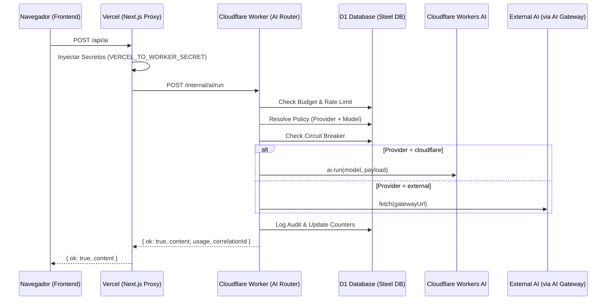

# Drako AI Router v1.1 (Steel Governance)

El AI Router es el componente central de orquestación de inteligencia para el ecosistema Drako. Implementa una estrategia "Cloudflare-first" y garantiza la gobernanza, observabilidad y control de costes en todas las llamadas a modelos de IA.

## Arquitectura

## Gobernanza Steel

### 1. Budgets (Cuotas)
Se aplican límites mensuales por `tenant_id`.
- **Soft Limit**: Genera una advertencia en los logs/auditoría.
- **Hard Limit**: Bloquea las peticiones con error `402 Payment Required`.

### 2. Rate Limiting
Control dinámico por `tenant_id` y `taskType` para evitar abusos o costes imprevistos.
- Ventana: 1 minuto.
- Límite default: 50 req/min/task.

### 3. Circuit Breaker
Protección persistente contra fallos de proveedores o modelos específicos.
- **OPEN**: Si un modelo falla >10 veces en 5 minutos, el circuito se abre.
- **Fallback**: Si el circuito está abierto, el router intenta degradar el servicio a una configuración Cloudflare AI por defecto (Llama 8B).

## Configuración de Políticas

Las reglas se gestionan en la tabla `ai_provider_policies`.

| Campo | Descripción |
|---|---|
| `tenant_id` | ID del tenant (o 'system' para globales) |
| `saas_id` | ID del SaaS específico |
| `task_type` | Tipo de tarea (marketing_copy, support_reply, admin_planning) |
| `mode` | `fast` (baja latencia) o `smart` (razonamiento alto) |
| `provider` | `cloudflare`, `openai`, `anthropic` |
| `model` | ID del modelo técnico |

## Observability

Todas las peticiones incluyen `X-Drako-Correlation-Id` (lowercase UUID v4).
Las auditorías se registran en `ai_request_audits` sin PII (Personally Identifiable Information).

### Comandos Útiles
- Ver uso actual: `SELECT tenant_id, tokens_used FROM ai_request_audits WHERE created_at > date('now', 'start of month')`
- Forzar apertura de circuito: `UPDATE ai_circuit_breakers SET state = 'OPEN', opened_at = CURRENT_TIMESTAMP WHERE key = 'ai:cloudflare:@cf/meta/llama-3.1-70b-instruct'`
