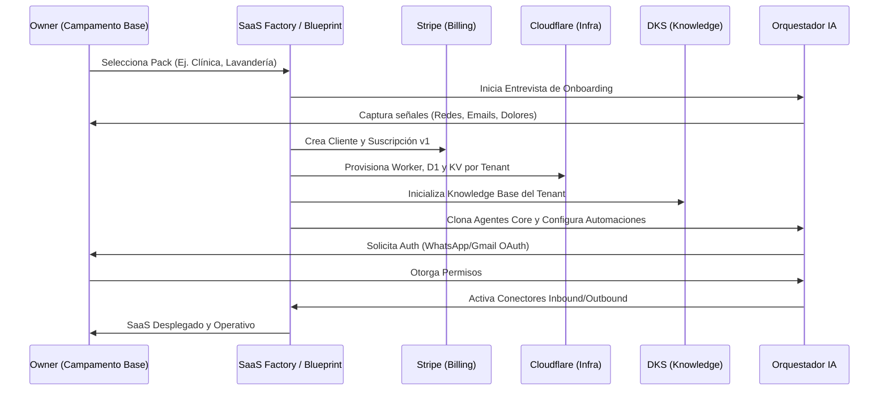

# 🚀 Plan Maestro: Fábrica de SaaS con Conectores IA (v1.1)

## 1. Introducción
Este plan define la estrategia para que **Campamento Base** actúe como una factoría automatizada de SaaS ("hijas"). La meta es que, tras un onboarding guiado, el sistema despliegue una infraestructura completa, funcional y conectada a canales de comunicación inteligentes sin intervención manual.

## 2. Flujo de Creación (Perspectiva del Agente IA)

## 3. Prompts Operativos para Agentes IA
Para una implementación detallada y el catálogo completo de prompts, consulta el [Catálogo de Prompts de Agentes de Fábrica](file:///c:/CAMPAMENTO%20BASE%20DRAKO/drako_base/docs/knowledge/prompts/factory-agents.v1.md) y el catálogo especializado [MentorIA Escolar](file:///c:/CAMPAMENTO%20BASE%20DRAKO/drako_base/docs/knowledge/prompts/mentoria-prompts.v1.md).

### 3.1 Drako Partner (Entrevista de Negocio)
**Nombre**: `interview-prompt`
Este agente guía al usuario por fases estructuradas: contexto, objetivos, finanzas, auditoría digital y diseño de solución.
- **Formato**: Conversacional humano con avisos tipo `🔍 INSIGHTS DE AUDITORÍA`.
- **Output**: Respuesta fluida al usuario + JSON de actualización de Blueprint para el sistema.

### 3.2 SaaS Builder Agent (Provisión)
**Nombre**: `saas-builder-prompt`
"Actúa como un experto en infraestructura de SaaS: configura el hosting (Cloudflare Pages), enlaza dominios, aplica migraciones D1, crea la estructura de base de datos, configura Stripe y conecta los agentes IA según el blueprint."

### 3.3 Agente de Dominio/SSL
**Nombre**: `domain-oauth-prompt`
Encargado de supervisar la gestión de DNS y certificados, así como la vinculación de identidades mediante OAuth para canales externos.

### 3.4 Agente Autopiloto / Action Queue
**Nombre**: `autopilot-prompt` y `channel-triage-prompt`
Monitorea métricas y tendencias. Evalúa eventos entrantes desde conectores para decidir si requieren respuesta automática, atención humana o alimentar al sistema de aprendizaje.

### 3.5 Vertical Educativa: MentorIA
**Prompts**: [mentoria-prompts.v1.md](file:///c:/CAMPAMENTO%20BASE%20DRAKO/drako_base/docs/knowledge/prompts/mentoria-prompts.v1.md)
Define la lógica para sub-agentes especializados:
- **Tutor**: Apoyo académico adaptativo.
- **Psicólogo**: Acompañamiento emocional y regulación.
- **Orientador**: Perfil vocacional y diagnóstico.
- **Orquestador Educativo**: Derivación inteligente y reportes a padres.

## 4. Servicios y Scripts de Core

| Servicio | Función / Descripción |
| :--- | :--- |
| **createAgentsForSaas** | Clona agentes base (`core_agents`) al nuevo SaaS según los packs asignados en el blueprint. |
| **ConnectorsService** | Gestiona el flujo OAuth2. Almacena tokens de forma segura vinculados al `tenant_id` (Vault) para uso exclusivo de los agentes. |
| **D1 Schema Initializer** | Ejecuta `wrangler d1 migrations apply` para el nuevo tenant y aplica las semillas (seeds) iniciales. |
| **Stripe Factory** | Crea el `Product` y `Price` en Stripe según el blueprint. Gestiona webhooks para activar el SaaS tras el `checkout.completed`. |

## 5. Diseño del SaaS Builder Agent
El "Constructor" es el encargado de materializar el blueprint.
- **Responsabilidades**: Generar IDs, crear registros en D1, provisionar Cloudflare Pages/DNS/SSL, y configurar el billing.
- **Entorno**: Ejecución Serverless/Edge (Next.js + Cloudflare Pages). Acceso a bindings de D1, KV, R2, Vectorize y Stripe Secret.
- **Registro**: Cada paso se loguea en `orchestrator_messages` y `agent_logs` para auditoría total.

## 6. Infraestructura Mínima del SaaS Hijo

| Componente | Función / Descripción |
| :--- | :--- |
| **Hosting (Pages)** | App Next.js desplegada en el Edge de Cloudflare. |
| **Base de Datos (D1)** | D1 Relacional multi-tenant (`DRAKO_DB`). Separación por esquema o tenant_id. |
| **DNS/SSL** | Gestión de dominios propios o subdominios `*.apps.drako.systems`. |
| **Stripe** | Gestión de suscripciones, planes y webhooks de pago. |
| **Action Queue** | Sistema de colas para tareas automáticas y recomendaciones. |
| **Almacenamiento (R2)** | Repositorio para facturas, medios y archivos de conocimiento del cliente. |
| **Vector DB (Vectorize)** | Índices de embeddings para la base de conocimiento específica del tenant. |
| **Queues** | Procesamiento asíncrono de tareas pesadas (sync de emails, provisión). |

## 7. Observabilidad y Sincronización
- **Logging Centralizado**: Cada petición incluye `x-drako-tenant-id` para filtrado selectivo en logs de D1 y audit events.
- **Knowledge Sync**: El `KnowledgeBasesService` mantiene sincronizados los datos de R2 y Vectorize. Al ingresar nuevos correos (Gmail) o documentos, el sistema actualiza los embeddings automáticamente para que los agentes operen siempre con contexto actualizado.

---
*Drako Factory — Orchestrating the future of SaaS.*
