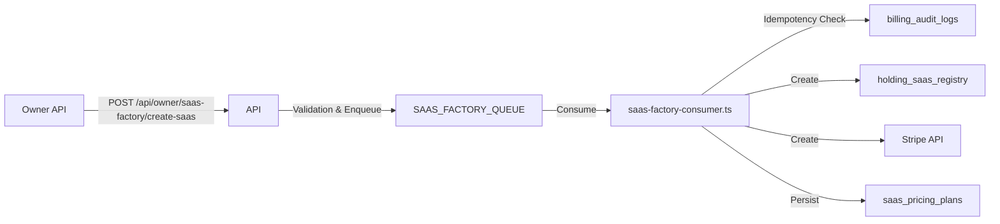

# Automated SaaS Factory Documentation

## Overview
The **SaaS Factory** allows the Owner of Campamento Base to create new SaaS subsidiaries (e.g., `mentoria`, `socialflow`) automatically.
It orchestrates:
1.  **Registry**: Registration in `holding_saas_registry`.
2.  **Stripe**: Creation of Product and 3 basic Prices (Starter, Pro, Scale).
3.  **Plans**: Persistence of pricing plans in `saas_pricing_plans`.
4.  **Audit**: Full audit logging in `billing_audit_logs`.

## Architecture



## Usage

### 1. Requirements
- **Cloudflare**: Bindings for `DRACO_DB` (D1) and `SAAS_FACTORY_QUEUE` (Queue).
- **Stripe**: `STRIPE_SECRET_KEY` in environment secrets.

### 2. API Endpoint
**POST** `/api/owner/saas-factory/create-saas`

**Headers:**
- `Content-Type: application/json`
- Auth headers (Session/Cookie) for Owner (handled by middleware).

**Body:**
```json
{
  "saasSlug": "new-saas",
  "name": "New SaaS Product",
  "plans": [
    {
      "planCode": "starter",
      "monthlyPriceCents": 1900,
      "currency": "eur",
      "limitsJson": { "users": 5 },
      "departmentsJson": ["default"]
    },
    { "planCode": "pro", "monthlyPriceCents": 4900, "currency": "eur", "limitsJson": {}, "departmentsJson": [] },
    { "planCode": "scale", "monthlyPriceCents": 9900, "currency": "eur", "limitsJson": {}, "departmentsJson": [] }
  ],
  "dryRun": false
}
```

### 3. Verification
Use the included script to verify the flow E2E (requires running dev server).

**Dry Run:**
```bash
npx tsx scripts/verify-saas-factory.ts
```

**Live (Real Stripe/DB):**
```bash
npx tsx scripts/verify-saas-factory.ts --live
```

## Fail-Closed Policy
- If **Validation** fails: API returns 400. Job not queued.
- If **Stripe** fails: Worker rolls back DB status to `disabled` and logs `CRITICAL` audit error.
- If **DB** fails: Worker logs error. Queue will retry (be careful of side effects, but idempotency checks should handle it).

## Idempotency
- **Deduplication**: Checks `billing_audit_logs` for `correlationId`.
- **Registry**: Checks if `saasSlug` exists. Returns success (skipped) if so.
